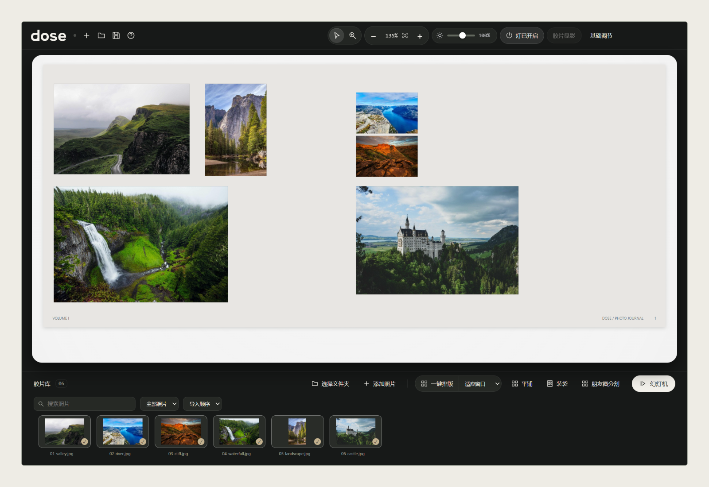

# dose

**A local photo workspace for Windows.** Spread out your photographs, choose a set, compare film looks, develop a frame, and turn it into something worth revisiting.

[Download for Windows](https://github.com/chongchonghaoman/dose/releases/latest) · [中文](README.md) · [Build](docs/BUILD.md)

- **Light table.** Arrange photos freely or use grids, sleeves and editorial layouts. Search, filter and sort the library.
- **Single-photo view.** Zoom, pan, step through the current selection and hold Space to compare the original. Return without losing the table layout.
- **Film looks.** Browse LUT previews rendered from the current photo, save favorites and import `.cube` / HaldCLUT files.
- **Built-in darkroom.** Enter the SpektraLab Windows editor from dose and return the result as a separate 16-bit ProPhoto RGB TIFF, retaining the original and editing recipe.
- **Share a set.** Create compositions and nine-tile exports or revisit the photos in a slide projector.

Download `dose-0.28.0-Windows-x64.zip`, extract the entire folder, then run `dose.exe`. Windows 10/11 x64. The native darkroom requires a Vulkan-capable GPU and driver. This release is unsigned; verify its origin and SHA-256. No account is required and photos are processed locally. Library records reference your originals and are not a backup.

For development, install Node.js 22.12+, then run `npm ci`, `npm run prepare:runtime`, and `npm start`. Runtime preparation retrieves and verifies the pinned release. See [BUILD.md](docs/BUILD.md) for frontend builds, tests, packaging and complete corresponding native sources.

dose maintains its photo workflow, LUT browsing, layout/share features and editor integration. The light-table upstream is [LightTable](https://github.com/fuyuan9972-svg/LightTable) (MIT); film simulation comes from [SpektraLab](https://github.com/JamesQiu2005/SpektraLab) and its [Windows community version](https://github.com/LUOJW5566/SpektraLab). The integrated distribution is GPL-3.0-or-later. Component and material licenses remain separate; see [THIRD_PARTY_NOTICES.md](THIRD_PARTY_NOTICES.md). dose is an independent project, not an official release or endorsement from those authors.

