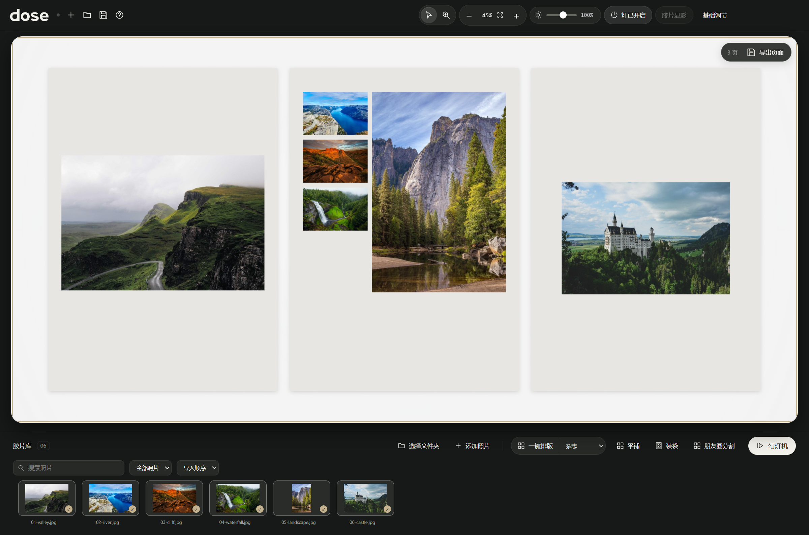
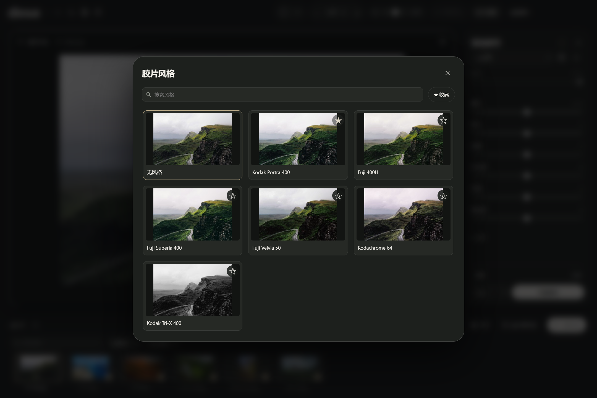
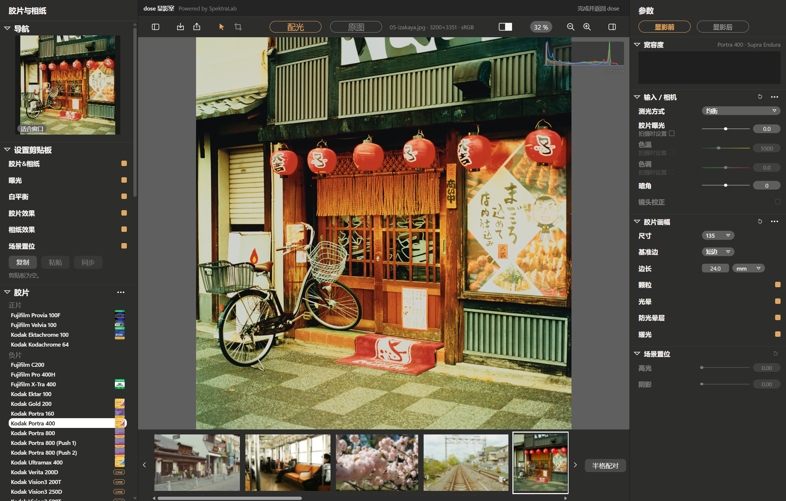

<p align="center">
  <picture>
    <source media="(prefers-color-scheme: dark)" srcset="assets/brand/dose-wordmark-light.svg">
    
  </picture>
</p>

<h1 align="center">那些日子，慢慢显影。</h1>

<p align="center">选一组照片，排成自己的摄影杂志。Windows · 本地处理 · 开源</p>

<p align="center">
  <a href="https://github.com/chongchonghaoman/dose/releases/latest">下载 Windows 版</a> ·
  <a href="#功能">功能</a> ·
  <a href="docs/BUILD.md">本地开发</a> ·
  <a href="README.en.md">English</a>
</p>


dose 是一个 Windows 照片工作台。挑好一组照片，点一下排版，就能把它们排成几页摄影杂志。喜欢的一张可以放大做主图，颜色也能在这里继续调，排好后按页保存。

上面这组六张日本日常照片排了三页。居酒屋门口那张做主图，几张小照片放在下面，前后的单图页留出了更大的空白。

## 功能

### 杂志排版

在「一键排版」旁选择「杂志」，dose 会按照片顺序安排页面。横片与竖片保留各自比例，单图页和图组穿插着排，整组可以铺在台面上一起看。

想让某一张更显眼，选中它，点击「设为主图」。再试其他版式时，这张照片仍会占据主要位置。

再点一次「一键排版」就能换个构图，也可以选中某一页的照片，只重排这一页。照片多时，可以试试「九页杂志」。



### 按页保存

排好后，点击右上角的「导出页面」。每页保存成一张 JPEG 或 PNG，文件按阅读顺序编号，照片的调色和位置随版面一起保存。长边可选 **2400、3600、4800 像素**，带 sRGB 色彩配置。

[查看实际导出的主图页](docs/media/magazine-page.jpg) · [0.29 更新记录](CHANGELOG.md)

### 观片台

照片可以自由摆放，也有网格和胶片袋视图。选中照片按 <kbd>E</kbd> 查看大图，放大检查细节，返回后继续刚才的排版。图库支持文件名搜索，照片多时可以筛选已放置或未放置的部分。

### 胶片风格

打开风格列表，就能看到当前照片在不同 LUT 下的效果。选好后可以调整强度和曝光，按住空格查看原图。常用风格支持收藏，也能导入自己的 `.cube` 或 HaldCLUT 文件。



### 显影室

打开「胶片显影」，可以在内置的 SpektraLab 显影室里搭配胶片与相纸，继续调整曲线和颗粒。调完返回 dose，这张照片就能接着放进版面。

显影结果另存为 16-bit ProPhoto RGB TIFF，原片和配方一起保留。下次打开时，可以继续修改之前的参数。



### 分享

分享画布也提供杂志排版，可以切成九宫格导出。幻灯机模式适合逐张回看，键盘左右键就能换片。

## 开始使用

1. 打开 **[Releases → 最新版本](https://github.com/chongchonghaoman/dose/releases/latest)**。
2. 下载 `dose-0.29.0-Windows-x64.zip`。
3. **完整解压**，双击其中的 `dose.exe`。导入照片后即可使用。

便携版解压即可运行，请保留文件夹中的全部文件。开发者可以下载同一 Release 中的 `dose-0.29.0-source.zip` 获取完整对应源码。

运行环境为 Windows 10/11 x64；内置显影引擎需要支持 Vulkan 的显卡与驱动。当前版本未签名，Release 提供 SHA-256 校验文件。

常用操作：<kbd>E</kbd> 打开／收起单张照片视图，<kbd>F</kbd> 适应窗口，<kbd>←</kbd> <kbd>→</kbd> 切换照片，按住 <kbd>Space</kbd> 对比原图，<kbd>Ctrl</kbd> + <kbd>F</kbd> 搜索图库。

## 文件与导出

- 照片在本地处理，打开应用即可使用。
- 编辑结果另存，原始文件保留。图库和排版记录引用原片路径，备份时请同时保存原照片。
- 配置保存在 `%APPDATA%/lighttable-windows`，这是沿用的兼容目录名。
- LUT 调整后可导出带 sRGB ICC 的 JPEG / PNG；原生显影保存为 16-bit TIFF。
- 杂志按页导出为带 sRGB ICC 的 JPEG / PNG，按阅读顺序编号，保存在新的独立文件夹中。

当前已验证 JPEG、PNG、HEIC 与部分 DNG 工作流。其他相机 RAW 和显卡的测试结果，欢迎通过 Issue 补充。

## 本地开发

需要 Windows x64 和 Node.js 22.12+ / npm。应用代码在 `src/`，显影前端在 `vendor/spektralab/desktop/`。

```powershell
git clone https://github.com/chongchonghaoman/dose.git
cd dose
npm ci
npm run prepare:runtime
npm start
```

`prepare:runtime` 下载并校验固定版本的 Release，提取原生引擎与显影前端。修改显影前端后再运行：

```powershell
npm ci --prefix vendor/spektralab/desktop
npm run build:editor
npm test
npm run test:preferences
npm run package
```

输出在 `build-output/dose-win32-x64/`。完整原生对应源码、依赖来源与重建方法见 [构建说明](docs/BUILD.md)；Release 同时提供 `dose-0.29.0-source.zip`。构建时需另行安装说明中列出的工具链。

## 来源与许可

感谢以下项目的作者，他们的工作帮助 dose 完成了观片台与胶片显影。

| 项目 | 在 dose 中的作用 | 许可／来源 |
| --- | --- | --- |
| [LightTable](https://github.com/fuyuan9972-svg/LightTable) | 观片台的上游项目；本仓库以 fork 保留历史 | MIT，保留[原始声明](licenses/LightTable-MIT.txt) |
| [SpektraLab](https://github.com/JamesQiu2005/SpektraLab) | 胶片、相纸与显影引擎 | GPL-3.0-or-later，原始许可随包提供 |
| [SpektraLab Windows 社区版](https://github.com/LUOJW5566/SpektraLab) | 内置显影前端与参考原生运行时 | GPL-3.0-or-later，见[来源记录](vendor/spektralab/README.md) |
| [Pat David / HaldCLUT](https://github.com/NatronGitHub/clut) | 内置的六款胶片风格 LUT | CC BY-SA 4.0，见 [LUT 声明](assets/luts/NOTICE.md) |

dose 由本项目独立维护，集成发行版使用 [GPL-3.0-or-later](LICENSE)。第三方代码、字体、色彩数据和素材保留各自许可，详见 [第三方声明](THIRD_PARTY_NOTICES.md) 与 [HEIC 说明](HEIC-NOTICES.md)。日本日常示例照片来自 Unsplash 的摄影师，作者、作品与许可见 [照片出处](docs/PHOTO-CREDITS.md)。

## 反馈

使用中遇到问题，可以提交 [Issue](https://github.com/chongchonghaoman/dose/issues)，附上版本、显卡和复现步骤。涉及照片时，请使用可公开的小样。也欢迎提交 Pull Request。

觉得 dose 用得上，欢迎点一个 Star。

