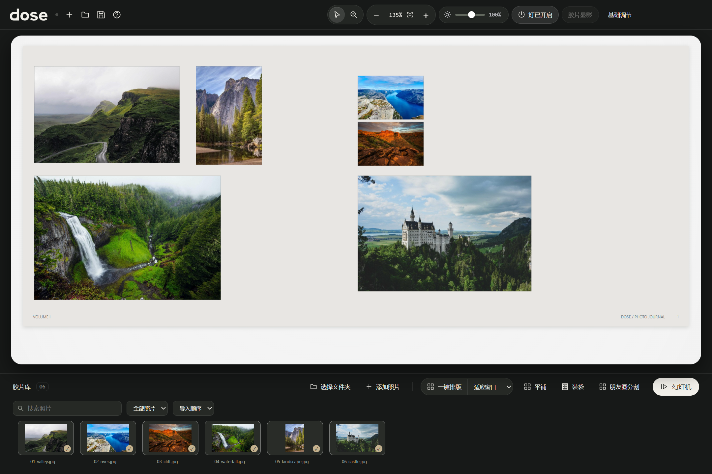

<p align="center">
  <picture>
    <source media="(prefers-color-scheme: dark)" srcset="assets/brand/dose-wordmark-light.svg">
    
  </picture>
</p>

<h1 align="center">那些日子，慢慢显影。</h1>

<p align="center">一个让你愿意重新打开照片的 Windows 工作台。</p>

<p align="center">
  <a href="https://github.com/chongchonghaoman/dose/releases/latest">下载 Windows 版</a> ·
  <a href="#从一张照片到一组作品">功能</a> ·
  <a href="docs/BUILD.md">本地开发</a> ·
  <a href="README.en.md">English</a>
</p>


照片越拍越多，回看的时间却越来越少。

**dose 把整理、选片、调色和分享放在一张桌面上。** 把照片摊开，放大看看细节；用同一张照片比较胶片风格；需要更细致的显影时，再进入暗房。最后，让散落在文件夹里的照片，变成一组愿意再次翻看的作品。

本地处理 · 保留原片 · 无需账户

## 从一张照片，到一组作品

### 摊开，才看得见照片之间的关系

自由摆放、网格、胶片袋和杂志排版，让选片有了空间。搜索文件名，筛选已放置或未放置的照片，按名称或导入顺序查看。选中一张进入大图，返回时，桌面还在原来的位置。



### 风格，用自己的照片来选

LUT 列表直接显示当前照片的效果。先看，再选，再调整强度；喜欢的风格可以收藏。曝光、对比度、冷暖与质感留在手边，也可以导入自己的 `.cube` 或 HaldCLUT。

按住空格看原图，松开继续。基础调节只走 LUT 模式，入口保持简单。


### 想慢慢调，再进显影室

**Windows 版已内置 SpektraLab 显影工作区。** 从 dose 打开照片，选择胶片与相纸，调整显影前后参数、曲线、颗粒和片边；保存后，结果回到 dose，继续整理与排版。

显影结果作为独立的 16-bit ProPhoto RGB TIFF 保存，保留原片与编辑记录。再次编辑会找到对应原片，避免把已显影的结果重复显影。


### 留下照片，也留下这一组的样子

在观片台里整理成组，使用幻灯机回看；将排版导出为分享图或九宫格。照片与照片之间的顺序、留白和节奏，也是作品的一部分。

## 开始使用

1. 打开 **[Releases → 最新版本](https://github.com/chongchonghaoman/dose/releases/latest)**。
2. 下载 `dose-0.28.0-Windows-x64.zip`。
3. **完整解压**，双击其中的 `dose.exe`。导入照片后即可使用。

这是便携版，无需安装。不要只把 `dose.exe` 单独移出文件夹；运行依赖同目录中的资源。GitHub 自动生成的 `Source code` 是源码下载，普通使用请选择上面的 Windows ZIP。

**环境：** Windows 10/11 x64；内置显影引擎需要支持 Vulkan 的显卡与驱动。当前版本未做代码签名。遇到 Windows 提示时，请先核对下载来源与 Release 中的 SHA-256，不需要关闭系统防护。

常用操作：<kbd>E</kbd> 打开／收起单张照片视图，<kbd>F</kbd> 适应窗口，<kbd>←</kbd> <kbd>→</kbd> 切换照片，按住 <kbd>Space</kbd> 对比原图，<kbd>Ctrl</kbd> + <kbd>F</kbd> 搜索图库。

## 照片留在你的电脑上

- 照片处理在本地完成，不上传照片，不需要登录。
- 编辑结果另存，原始文件保留。图库和排版记录会引用本地原片；**项目记录不能代替原片备份**。
- 配置保存在 `%APPDATA%/lighttable-windows`，这是沿用的兼容目录名。
- LUT 调整后的常规导出为带 sRGB ICC 的 JPEG / PNG；原生显影保留 16-bit TIFF。两条导出路径的用途和精度不同。

当前已验证 JPEG、PNG、HEIC 与部分 DNG 工作流。不同相机 RAW、显卡和大图库的表现仍需要更多实测；发现问题欢迎附上环境和复现步骤。

## 本地开发

需要 Windows x64 和 Node.js 22.12+ / npm。应用代码在 `src/`，显影前端在 `vendor/spektralab/desktop/`。

```powershell
git clone https://github.com/chongchonghaoman/dose.git
cd dose
npm ci
npm run prepare:runtime
npm start
```

`prepare:runtime` 下载并校验固定版本的 Release，提取原生引擎与显影前端。修改显影前端后再运行：

```powershell
npm ci --prefix vendor/spektralab/desktop
npm run build:editor
npm test
npm run test:preferences
npm run package
```

输出在 `build-output/dose-win32-x64/`。**完整原生对应源码**、依赖来源与从源码重建引擎的方法见 [构建说明](docs/BUILD.md)；Release 同时提供 `dose-0.28.0-source.zip`。工具链需自行安装，源码包不是离线工具链。

## dose 做了什么

dose 围绕一条完整的照片工作流设计：**观片台 → 单张查看 → 风格比较 → 显影 → 成组分享**。

本项目实现与持续维护的部分包括照片工作台、单张查看状态、当前照片 LUT 预览与收藏、图库筛选、排版与九宫格分享，以及显影工作区的打开、保存、返回和原片追踪。界面遵循一个简单原则：少一些重复标签，让照片和布局说明怎么用。

胶片与相纸的物理模拟建立在 SpektraLab 的工作之上。我们保留它的材料模型与来源，专注于把照片前后两端的使用体验做好。

## 来源与许可

感谢让这份工作成为可能的开源作者：

| 项目 | 在 dose 中的作用 | 许可／来源 |
| --- | --- | --- |
| [LightTable](https://github.com/fuyuan9972-svg/LightTable) | 观片台的上游项目；本仓库以 fork 保留历史 | MIT，保留[原始声明](licenses/LightTable-MIT.txt) |
| [SpektraLab](https://github.com/JamesQiu2005/SpektraLab) | 胶片、相纸与显影引擎 | GPL-3.0-or-later，原始许可随包提供 |
| [SpektraLab Windows 社区版](https://github.com/LUOJW5566/SpektraLab) | 内置显影前端与参考原生运行时 | GPL-3.0-or-later，见[来源记录](vendor/spektralab/README.md) |
| [Pat David / HaldCLUT](https://github.com/NatronGitHub/clut) | 内置的六款胶片风格 LUT | CC BY-SA 4.0，见 [LUT 声明](assets/luts/NOTICE.md) |

dose 的集成发行版使用 **[GPL-3.0-or-later](LICENSE)**；第三方代码、字体、色彩数据和素材保留各自许可。dose 是独立项目，不代表上述作者的官方发布或背书。完整信息见 [第三方声明](THIRD_PARTY_NOTICES.md) 与 [HEIC 说明](HEIC-NOTICES.md)。演示截图中的测试照片来自 [Lorem Picsum](https://picsum.photos)，摄影版权归原作者，未作为内置照片分发。

## 一起把它做好

欢迎提交 [Issue](https://github.com/chongchonghaoman/dose/issues) 或 Pull Request。报告问题时请写明 dose 版本、Windows 版本、显卡与复现步骤；涉及照片时，优先提供可公开的小样，保留自己的隐私。

如果 dose 让你重新打开了一组很久没看的照片，欢迎点一个 Star，让更多人找到它。

