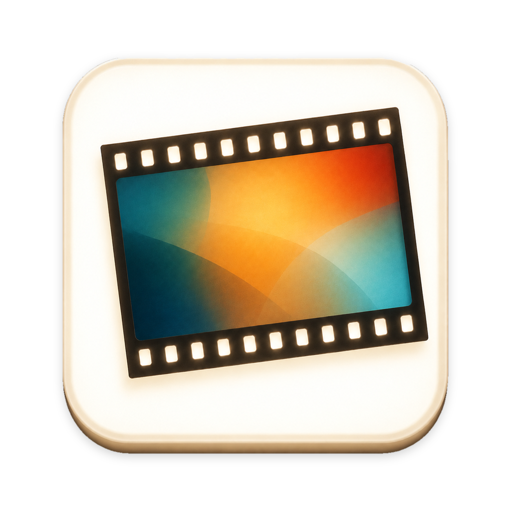

# 观片台 · LightTable



一款本地运行的 macOS 观片应用，模拟反转片灯箱与幻灯机。导入照片，自由摆片、开灯、用放大镜观察，或进入黑底全屏幻灯模式。

A local macOS light table and slide projector for viewing photographs, with in-app GitHub updates.

v0.1.107 开放 EDR 亮度调节，并优化幻灯片音效；延续「背光 EDR」的透光感、明暗层次与照片细节。完整内容及操作见 [更新说明](docs/releases/v0.1.107.md)。

## 下载与运行

- 系统要求：**macOS 14 或更新版本**。
- 预编译安装包面向 **Apple Silicon（M 系列芯片，arm64）**；Intel Mac 暂无预编译包，也未验证运行。
- 安装包可在 [GitHub Releases](https://github.com/fuyuan9972-svg/LightTable/releases/latest) 下载。解压后打开「观片台.app」，也可自行拖入「应用程序」。
- **运行应用不需要 Xcode、Swift 或剪映**。开发工具仅用于从源码构建。
- 当前安装包使用 ad-hoc 本地签名，未经过 Apple 公证；首次打开时，macOS 可能提示无法验证开发者。请先确认下载来源，再按系统提示处理；如不希望运行未公证的安装包，可以自行构建。

当前版本 **[v0.1.107](https://github.com/fuyuan9972-svg/LightTable/releases/tag/v0.1.107)**：EDR 亮度自由调节，幻灯片自动采用 EDR，并优化加载、首张与换片音效。

**[直接下载 macOS 安装包（Apple Silicon）](https://github.com/fuyuan9972-svg/LightTable/releases/download/v0.1.107/LightTable-v0.1.107-macOS-arm64.zip)**

从v0.1.65升级，需手动下载安装一次带更新功能的版本，之后可在App内更新。

重启先准备台面高清预览，再进入观片；空台面直接进入，读取失败可重试。整理全局快捷键为 **⇧Z**。底栏删除及取片收回的用法见[操作指引](docs/本次更新操作指引-v0.1.74.md)。

## 应用内更新

- 每次完整退出后重新启动，台面准备完成就检查GitHub正式版本一次，不受上次检查时间或周期检查开关影响；同一次运行中开启多个窗口不会重复检查。无新版或启动检查断网时不弹窗，不上传照片或布局。
- 有新版时提示版本与更新内容；点击下载后，在App内选择「安装并重启」。安装前验证更新包与更新信息的签名，重启前保存布局。
- 曾跳过的版本，下次启动也会重新提示。菜单栏「观片台 → 检查更新…」可随时手动检查；「运行期间自动检查更新」只控制持续运行时每24小时的周期检查。
- 下载或网络错误可重试，不修改现有应用；更新包由GitHub Releases提供。
- v0.1.70起提供签名更新源。发行维护说明见 [发布步骤](docs/RELEASING.md)。

## 本版更新说明

首次打开v0.1.107时显示说明卡，以「背光 EDR」的透光感、层次与细节为主，介绍快捷切换和亮度控制，并补充「优化幻灯片音效」。点击「开始观片」继续。本次说明仅自动展示一次，菜单「帮助 → 本次更新…」可以重看。旧版操作指南保留在文档中。

## 功能

- 导入照片或文件夹，包含子文件夹，追加到当前底栏；➕新建底栏，点击标签切换。
- 从底栏拖片到台面后底栏隐藏该片；自由移动、旋转、缩放，Delete收回原底栏、原顺序。
- 点选底栏照片或文件名后按 Delete，删除单张；右键底栏标签 →「删除底栏」移除整栏。两者均移除台面对应散片，其他底栏、独立相册和磁盘原图保留。
- 「一键平铺」将当前底栏的照片重新摆放到台面；**会清空当前散片布局并重新排列**。
- 开关灯与亮度调整，带短暂过曝回落效果。
- 背光 EDR：启动默认关闭，点击顶部按钮或按 E 开启；默认亮度120%，可用滑块在10%–160%之间调整。双击恢复当前模式默认值，普通模式与EDR分别保留本次运行的亮度。
- 普通放大镜1.5×；按住空格凑近，可选随窗口适配的原倍率或固定8×，松开退回。
- 胶片袋式相册页与整页摆放。
- 全屏幻灯：黑色背景、居中单张照片、随机播放顺序和机械换片动画；自动启用EDR并使用设定的EDR亮度，返回保留台面原状态。幻灯模式不显示放大镜。
- 「回到过去」：从底栏拖入原始照片，本机生成高斯场景，黑场逐粒显现；左键旋转、右键平移、滚轮／捏合缩放，双击复位。
- 首次使用「回到过去」联网下载环境与模型，之后复用；无16 GB硬门槛，8 GB设备尚未实测。SHARP模型仅限非商业科学研究，禁止产品开发或商业产品／服务用途，详见第三方许可说明。
- 布局和预览缓存保存在本机；不修改照片原文件。
- 幻灯片加载保持静音，首张入场保留原有声音，后续换片采用较轻的机械按键声，播放音量为15%。

## 使用

1. 点击「从文件夹导入」或「添加照片」，也可以把照片、文件夹拖入当前底栏；点击➕新建底栏。
2. 将照片拖到台面，或点击「一键平铺」放置全部照片。
3. 开灯观看，通过亮度滑杆调整灯箱；选中台面照片后可旋转、缩放，按 Delete 或右键「收回底栏」放回原栏。点选底栏照片按 Delete 删除单张；右键底栏标签 →「删除底栏」删除整栏。仅切换标签或刚导入后按 Delete 不会删除整栏。
4. 切换到放大镜，其右侧会出现「原倍率 / 8×」胶囊；点击、拖动或按Tab切换倍率，用鼠标移动取景，按住空格凑近观察。凑近时也可按Tab切换；切回普通指针时隐藏倍率控件。
5. 点击幻灯片按钮进入全屏；按 **↓ / →** 看下一张，按 **↑ / ←** 返回上一张。
6. 点击「返回观片台」或按 **Esc** 退出幻灯，回到原来的台面。
7. 点击「回到过去」，从底栏拖照片进入播放区，等待下载（首次使用）、推理和场景加载。播放时可小幅移动视角，按 **Esc** 返回。详见[操作说明](docs/releases/v0.1.87.md)。

收回照片、删除底栏照片和删除整栏都不会删除磁盘原图。照片仍从原路径读取，请保留导入文件的位置。

| 快捷键 | 操作 |
| --- | --- |
| ⌘O | 从文件夹追加导入当前底栏 |
| ⇧⌘O | 添加照片 |
| ⌘L | 开灯 / 关灯 |
| A / V | 普通指针 / 放大镜 |
| Tab | 放大镜模式下切换原倍率 / 8× |
| 按住空格 | 凑近观察；松开退回 |
| E | 开关背光 EDR；按住空格凑近时也可使用 |
| ⇧Z | 整理台面并回到全局 |
| ⌘点选 / Shift拖动 | 多选 / 框选台面照片 |
| Delete | 台面选中照片：收回原栏；底栏选中照片：删除该张及台面对应散片 |
| ↓ / →、↑ / ← | 幻灯模式下下一张、上一张 |
| Esc | 退出幻灯模式 |

## 从源码构建

需要 macOS 14+、Swift 5.9 或更新版本，以及 Apple Command Line Tools。也可以使用完整 Xcode 提供的工具链。

```sh
xcode-select --install
git clone https://github.com/fuyuan9972-svg/LightTable.git
cd LightTable
swift build
zsh scripts/build-app.sh
```

已有 Command Line Tools 时跳过第一条命令。构建结果是 `dist/观片台.app`；脚本会执行 Release 构建、生成应用包并进行 ad-hoc 本地签名，不会自动安装或运行应用。

历史构建入口 `build_release.sh` 转发到同一个构建脚本。可通过参数指定输出路径：

```sh
zsh scripts/build-app.sh "dist/custom/观片台.app"
```

项目使用 SwiftUI、AppKit、Core Image 和 Metal；SwiftPM固定依赖Sparkle 2.10.0用于更新，首次构建需下载依赖。源码可自行编译；目前不声明 Intel 构建或运行已经验证。

## 检查

以下独立检查直接编译生产源码，不需要 XCTest：

```sh
bash scripts/check.sh
bash scripts/check-drops.sh
bash scripts/check-loupe.sh
bash scripts/check-sleeves.sh
bash scripts/check-closeup.sh
bash scripts/check-albums.sh
bash scripts/check-slideshow.sh
bash scripts/check-updates.sh
bash scripts/check-feature-guide.sh
bash scripts/check-trays.sh
bash scripts/check-tray-return.sh
```

它们覆盖布局、拖放、灯光、镜片、相册与幻灯状态等逻辑。图形相关检查需要能够使用 macOS 图形框架的环境；检查通过不等于所有设备上的动画流畅度已经实测。

安装完整 Xcode 并选用其工具链后，还可以运行 SwiftPM 测试：

```sh
swift test
```

## 反馈与许可

通过 [Issues](https://github.com/fuyuan9972-svg/LightTable/issues) 报告问题，请附 macOS 版本、芯片型号和复现步骤。提交截图或录屏前，请移除不希望公开的照片及个人信息。

开源基础代码采用 [MIT 许可证](LICENSE)。EDR二进制组件不在MIT授权范围，遵循 [EDR组件许可](Binaries/EDR-LICENSE.txt)；实现源码不随仓库发布。Sparkle、SHARP、PlayCanvas、OOOSplat及第三方音频遵循各自许可，不纳入本项目的MIT授权；依赖与素材说明见 [THIRD_PARTY_NOTICES.md](THIRD_PARTY_NOTICES.md)，版本变化见 [CHANGELOG.md](CHANGELOG.md)。


## EDR 组件与构建

源码构建使用随仓库提供的二进制组件，无需私有源码。发布边界与维护流程见 [分发说明](docs/DISTRIBUTION.md)。
